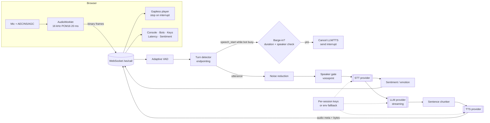

# Voice AI Orchestrator

A realtime voice bot orchestration platform for Indian languages. You bring your own keys, and it chains **any STT → any LLM → any TTS** over a single WebSocket. It handles barge-in, VAD-based turn detection, noise reduction, a primary-speaker lock, live sentiment and emotion, and per-layer latency metrics. It's a FastAPI service with a web console and no build step, deployable to Render in one click.

[](https://render.com/deploy?repo=https://github.com/VinothSakthivadivel/voice-ai-orchestrator)

> Try it without keys: the **"Demo - real voice (no keys)"** bot speaks with free Microsoft Edge neural voices (English-India by default; switch its language to hi-IN, ta-IN, te-IN, bn-IN, mr-IN, gu-IN, kn-IN, ml-IN, ur-IN or ne-IN). Its STT and LLM are mocks that echo what you say or type. The **"Mock tones"** bot is fully offline and plays placeholder **beeps, not speech**.

## Features

| Area | What you get |
|---|---|
| **Bring-your-own-keys providers** | **STT:** Sarvam (Saaras v4), Google Cloud STT, Azure Speech, AWS Transcribe (streaming SDK), Deepgram (nova-3), OpenAI (gpt-4o-transcribe / gpt-transcribe / Whisper), AssemblyAI. **LLM:** OpenAI, Anthropic Claude, Google Gemini, Azure OpenAI, AWS Bedrock (Converse), Groq, Mistral, Sarvam (Sarvam-105B), OpenRouter, any OpenAI-compatible endpoint (vLLM, Ollama, Together…). **TTS:** Sarvam Bulbul (v2/v3/v4-flash), Google TTS, Azure Neural TTS, AWS Polly, ElevenLabs, OpenAI TTS, **Free voices (no key)**: Edge neural, then gTTS, then the browser's speechSynthesis, plus a pure **browser speechSynthesis** option. Offline **mock** providers too (mock TTS = tones). |
| **Audio normalisation** | Every TTS output is sniffed and normalised on the server to raw **PCM16 LE mono at its native rate** before it's sent. That covers WAV of any bit depth, float, extensible or multi-channel, streaming WAVs with bogus sizes, raw PCM with an odd byte, and MP3/OGG/FLAC decoded with `miniaudio`. The browser never plays a WAV header or MP3 bytes as PCM. |
| **Keys** | Entered per browser session (Keys tab), sent only inside the call's WebSocket and never stored server-side or logged. Optional server env-var fallback. Logs are redacted, and provider error bodies are scrubbed of keys. A "Test" button checks each provider. |
| **Indian languages** | 23 languages: Hindi, Bengali, Tamil, Telugu, Marathi, Gujarati, Kannada, Malayalam, Odia, Punjabi, Assamese, Urdu, English (India), Konkani, Maithili, Sanskrit, Nepali, Sindhi, Kashmiri, Dogri, Manipuri, Bodo, Santali. Each provider's language and voice codes are mapped for you (e.g. Odia → `od-IN` on Sarvam, Punjabi → `pa-Guru-IN` on Google STT, Nepali → `ne-NP` on Azure). The **Languages** tab shows which provider supports what. |
| **Realtime pipeline** | Browser mic → AudioWorklet → 16 kHz PCM16 in 20 ms frames → WebSocket → adaptive VAD → turn detector (pre-roll, min-speech, end-of-turn silence, max utterance) → noise reduction → speaker gate → STT → **streaming** LLM → sentence chunker (handles `। ॥ ۔ ? !`) → TTS per sentence, played back gaplessly. |
| **Interruption / barge-in** | If the user talks for a sustained stretch (`barge_in_ms`) while the bot is thinking or speaking, the server cancels the LLM and TTS tasks and the client stops playback at once. In-flight audio from the cancelled turn is dropped, and the partial reply goes into history marked `[interrupted]`. Short coughs and clicks don't interrupt. A half-duplex mode is available, and you can also interrupt by typing or with a button. |
| **Noise & echo** | Browser `echoCancellation`, `noiseSuppression` and `autoGainControl` are always on. The server adds spectral-subtraction noise reduction using a noise profile learnt from non-speech frames (uses `noisereduce` if installed). The VAD noise floor adapts to steady fans and traffic. |
| **Speaker identification** | Primary-speaker lock: your voiceprint is enrolled from the first N seconds (or by "Re-enroll"). Utterances and barge-ins from other voices are ignored, with similarity shown live. Embedders are pluggable (`app/audio/speaker.py`). You can optionally keep only the primary **diarized** speaker's words from Deepgram, AssemblyAI or Google. |
| **Controls** | Temperature, max tokens, history length, system prompt/persona, greeting, TTS speed and pitch, emotion/style (Azure SSML `express-as` styles, OpenAI `gpt-4o-mini-tts` instructions, ElevenLabs stability/similarity/style), VAD thresholds, end-of-turn silence and barge-in delay. Temperature, speed, pitch, style, barge-in and the speaker lock can be **changed live during a call**. |
| **Sentiment & emotion** | Each user turn is scored instantly with a lexicon covering English, Hinglish and native-script cues in 10+ Indian languages, with negation and intensifier handling. An LLM-based classifier is optional. Results show on a live timeline (anger / sadness / fear / joy / surprise / gratitude / neutral). |
| **Admin UI** | Multiple saved bot profiles (create, duplicate, delete), a live call console with streaming transcript, per-turn latency (STT, LLM time-to-first-token, LLM total, first TTS chunk, end-to-end to first audio), sentiment chart, event log, and language and provider matrices. |
| **Ops** | `/health`, a `PORT` env var, optional `APP_ACCESS_TOKEN` gate for UI/API/WS, a session cap, a Render Blueprint and a Dockerfile. |

## Architecture



```
app/
  main.py              FastAPI app: REST, /ws/call, static UI, auth gate
  pipeline/session.py  Call orchestrator (VAD → STT → LLM → TTS, barge-in, metrics)
  pipeline/chunker.py  Streaming sentence splitter (Indic punctuation aware)
  providers/           base.py (registry, credentials) · stt.py · llm.py · tts.py · mock.py
  audio/               vad.py · denoise.py · speaker.py
  analysis/sentiment.py
  languages.py         Language catalog + per-provider code/voice maps
  store.py             Bot profiles (JSON, keys stripped)
static/                index.html · app.js · styles.css · capture-worklet.js
tests/                 pytest suite (mocked providers, no network)
```

## Run locally

```bash
python -m venv .venv && . .venv/bin/activate
pip install -r requirements-dev.txt
uvicorn app.main:app --reload --port 8000
# open http://localhost:8000  (mic access works on localhost or HTTPS)
pytest -q
```

Or with Docker: `docker build -t vao . && docker run -p 8000:8000 vao`.

## Deploy on Render

1. Click **Deploy to Render** above. Render reads `render.yaml` and creates one Python web service with a `/health` check.
2. When prompted for `APP_ACCESS_TOKEN`, either set a long random value, which users then enter once in the UI header, or leave it blank for an open demo.
3. Optional: add provider keys as env vars in the Render dashboard (see the table below). **If you add server-side keys, set `APP_ACCESS_TOKEN`**, otherwise anyone with the URL can spend your credits.
4. Open `https://<your-service>.onrender.com`, pick a bot, add keys in the **API Keys** tab (or use the demo bot), and click **Start call**.

Render terminates TLS, so the browser can use the mic (HTTPS) and the app connects over `wss://`. The free plan sleeps after about 15 minutes idle, so the first request takes some time to wake it up. Use a paid plan for production.

## Configuration

| Env var | Default | Purpose |
|---|---|---|
| `PORT` | set by Render | HTTP port |
| `APP_ACCESS_TOKEN` | – | If set, required as the `X-Access-Token` header or `?token=` for API and WebSocket |
| `ALLOW_ENV_KEYS` | `true` | Use provider env vars as a fallback when the session supplied no key |
| `DATA_DIR` | `data` | Where `bots.json` is stored |
| `MAX_SESSIONS` | `50` | Concurrent call cap |
| `LOG_LEVEL` | `INFO` | |

Provider keys (all optional, per-session keys take precedence):

| Provider | Env vars |
|---|---|
| Sarvam (STT/LLM/TTS) | `SARVAM_API_KEY` |
| Google Cloud STT/TTS | `GOOGLE_CLOUD_API_KEY` (API key with Speech-to-Text / Text-to-Speech enabled) |
| Google Gemini | `GEMINI_API_KEY` |
| Azure Speech (STT/TTS) | `AZURE_SPEECH_KEY`, `AZURE_SPEECH_REGION` (default `centralindia`) |
| Azure OpenAI | `AZURE_OPENAI_API_KEY`, `AZURE_OPENAI_ENDPOINT`, `AZURE_OPENAI_DEPLOYMENT`, `AZURE_OPENAI_API_VERSION` |
| AWS (Transcribe/Polly/Bedrock) | `AWS_ACCESS_KEY_ID`, `AWS_SECRET_ACCESS_KEY`, `AWS_SESSION_TOKEN`, `AWS_REGION` (default `ap-south-1`) |
| OpenAI | `OPENAI_API_KEY`, `OPENAI_BASE_URL` |
| Anthropic | `ANTHROPIC_API_KEY` |
| Deepgram / AssemblyAI / ElevenLabs | `DEEPGRAM_API_KEY` / `ASSEMBLYAI_API_KEY` / `ELEVENLABS_API_KEY` |
| Groq / Mistral / OpenRouter | `GROQ_API_KEY` / `MISTRAL_API_KEY` / `OPENROUTER_API_KEY` |
| Custom OpenAI-compatible | `OPENAI_COMPAT_BASE_URL`, `OPENAI_COMPAT_API_KEY` |

## WebSocket protocol (`/ws/call`)

Client → server: `{"type":"start","profile_id"|"profile":{…},"keys":{group:{field:value}}}` first, then binary PCM16 mono 16 kHz frames, plus `text`, `interrupt`, `playback_ended`, `enroll_speaker`, `update` (live profile patch) and `stop`.
Server → client: `ready`, `level`, `vad`, `transcript`, `state`, `llm_delta`, `audio` (JSON meta followed by one binary message: `wav` / `pcm16`), `assistant_done`, `interrupt`, `metrics`, `sentiment`, `speaker`, `error`.

## Known limitations

- **STT is utterance-level.** Audio is endpointed by the server VAD and then sent to the provider's REST/batch API (AWS uses its streaming SDK for the single utterance). There are no interim/partial transcripts yet. Native streaming STT (Deepgram/Azure/Google websockets) is the next step for lower latency.
- **The VAD is energy-based** with an adaptive floor, plus optional `webrtcvad`. Silero/neural VAD and semantic end-of-turn models aren't bundled because they'd need torch/onnx and a bigger image. The `EnergyVAD` interface is where you'd plug one in.
- **Speaker identification is basic.** The default voiceprint is MFCC + pitch statistics (numpy only). It separates clearly different voices (e.g. a male caller vs. a female TV voice) but **isn't reliable for similar voices** or as a security or biometric control. Tune the threshold per deployment, or plug in a neural embedder (ECAPA/resemblyzer). Provider diarization is only used on providers that return per-word speaker labels.
- **Server noise reduction** is classic spectral subtraction. It helps with steady noise (fans, hum) but not much with babble, and aggressive settings can slightly hurt STT accuracy on clean audio, so it can be turned off per bot.
- **Emotion/style support varies by provider and voice.** Azure `express-as` only applies to voices that support the style, Sarvam pitch and loudness only work on `bulbul:v2`, and Google and Polly have no emotion control.
- **Language coverage depends on the provider.** The support matrix reflects provider documentation as of Oct 2026 and is conservative. Konkani, Maithili, Sanskrit, Sindhi, Kashmiri, Dogri, Manipuri, Bodo and Santali currently have **STT only via Sarvam Saaras** (and a few via Whisper), and **no TTS provider in this list** supports them. LLM quality is weaker for low-resource languages.
- **Model deprecations.** OpenAI has announced shutdowns for `gpt-4o-mini` (2027-01-14), `/audio/speech` TTS models (2027-01-06) and the current transcribe models (2027-02-26). Defaults are editable per bot. OpenAI Realtime/GPT-Live speech-to-speech and Gemini Live aren't integrated in v1.
- **"Free voices" use unofficial public endpoints** (Edge read-aloud, Google Translate TTS). They're great for demos but have no SLA. For production use Sarvam, Azure, Google, ElevenLabs, Polly or OpenAI with your own key. There are no free neural voices for Odia, Assamese or the 8th-schedule minority languages; those fall back to the browser's voices if the device has them.
- **Real provider calls are exercised in tests with mocked HTTP only.** Request shapes follow each vendor's docs, but they haven't been verified against live keys in CI.
- **Bot profiles are a JSON file.** On Render without a persistent disk they reset on redeploy. Attach a Render Disk and point `DATA_DIR` at it, or swap in a database.
- **Not built in v1:** telephony (SIP/Twilio/Exotel), user accounts/RBAC, multi-tenant usage metering, horizontal scaling (sessions are in-process), and call recording/analytics storage.

## Tests

```bash
pytest -q   # 60 tests: provider registry, language mapping, VAD/turn detection, barge-in & speaker gate
            # with mock providers, sentiment, chunker, provider request shapes (httpx MockTransport), API + WebSocket
```
